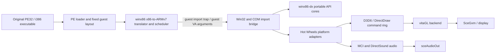
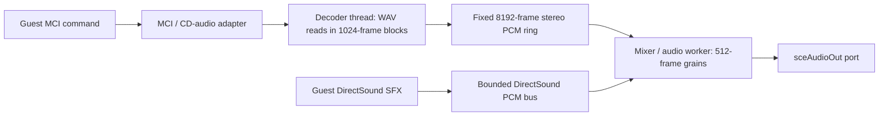
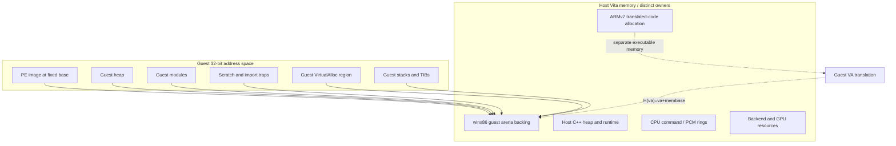

# Hot Wheels Micro Racers for PlayStation Vita

An experimental PS Vita runtime for the original **32-bit x86 Windows executable** of *Hot Wheels Micro Racers*. The port loads the PE32 executable and translates its x86 code to ARMv7 at runtime through the `winx86` engine. It does not recompile the game's logic, and it does not replace the game with a native rewrite.

The repository contains port code, reusable Win32 API cores, the published runtime dependency snapshot, build support and documentation. It does **not** contain the game executable, installer, tracks, music, textures, or other retail data. You must supply data from your own lawful copy. See [installation](hotwheels/docs/INSTALL.md), [build guide](docs/BUILDING.md), and [third-party notices](THIRD-PARTY-NOTICES.md).

> **Project status:** experimental and hardware-sensitive. Startup and gameplay have been exercised at different evidence levels, but this README makes no claim of stable frame rate, full API compatibility, complete track coverage, or a finished release. Read the evidence and limitations below before drawing conclusions.

## Contents

- [What runs, and how](#what-runs-and-how)
- [Frame production and rendering](#frame-production-and-rendering)
- [Audio and streamed resources](#audio-and-streamed-resources)
- [Guest memory and ownership](#guest-memory-and-ownership)
- [Win32 surface area](#win32-surface-area)
- [Evidence and performance claims](#evidence-and-performance-claims)
- [Build and run](#build-and-run)
- [Install with your own game data](#install-with-your-own-game-data)
- [Troubleshooting](#troubleshooting)
- [Repository map](#repository-map)
- [Approach compared with other port families](#approach-compared-with-other-port-families)
- [Dependencies, licenses, and credits](#dependencies-licenses-and-credits)

## What runs, and how

`HotWheels.exe` remains the guest program. The Vita runtime loads its PE32/i386 sections at the executable's required fixed image base, creates a 32-bit guest address space, registers imports as guest-callable traps, and starts the guest scheduler. When the guest reaches translated x86 code, `winx86` executes ARMv7 code generated from x86 basic blocks. Calls into unavailable Windows services cross an explicit import bridge into the port's shims and adapters.



The separation is intentional: `winx86` owns guest instruction execution and guest memory; `winx86-dx` supplies reusable host-side API behavior; Hot Wheels code owns the PE ABI, COM objects, Vita devices, rendering policy, file paths and title-specific behavior. These layers are not interchangeable with a complete Windows installation or a full DirectX implementation.

### PE loading and import ABI

The executable is a PE32 image for i386 with no relocation table, so the port loads it at its required base (`0x00400000`). The loader reads headers and mapped sections rather than copying the installer's large appended overlay into RAM. The guest address space is a 32-bit view backed by a bounded runtime arena; guest addresses stay guest addresses and are read or written through the runtime's `Cpu` interface. A guest VA is never treated as a native Vita pointer.

The import bridge installs function traps in guest memory. Each trap records the expected argument count and stack-cleanup convention. `stdcall` exports clean their arguments at return; `cdecl` leaves cleanup to the guest. COM interfaces are represented by guest-side objects and vtables whose method slots resolve to traps. Adapters marshal fixed-width guest structures and validate guest buffers before invoking portable cores. An import that has no registered shim is logged as unresolved; diagnostic boot policy can stop at the first such trap rather than continue with a guessed ABI.

### CPU translation, architectural state, and memory ordering

The guest instructions execute as translated x86 basic blocks on ARMv7. This is runtime translation, not source recompilation or a claim of universal x86 compatibility. Integer flags, control flow, x87 state, calling conventions, segment/TIB accesses and self-modifying-code behavior are correctness obligations of the translator and its runtime. Optimized instruction paths must preserve the same guest-visible state as the reference path. Floating-point corner cases and unsupported Windows behavior remain areas to validate against the original executable and a reference environment.

x86 normally presents a stronger memory-ordering model than ARMv7. The host cannot rely on x86 ordering when coordinating Vita threads: queue publication and shared diagnostics use C++ mutexes/condition variables or atomics with explicit acquire/release ordering where required. A release operation publishes preceding writes; the matching acquire makes them visible to the consumer. The frame queue itself currently uses a mutex and condition variable rather than a lock-free acquire/release protocol. Do not infer that each queue operation emits a specific `DMB`, `DSB`, or `ISB` instruction without checking the target build's assembly.

Generated ARM code also has an instruction/data-cache visibility requirement: code bytes written by the JIT must be visible to instruction fetch before execution. The Vita `winx86` port replaces the generic cache-clear path with Vita's VM-domain synchronization. That is separate from queue ordering and from GPU resource lifetime. Exact synchronization behavior belongs to the pinned runtime snapshot and Vita SDK implementation; see [runtime patches and provenance](hotwheels/docs/winx86-patches.md) and [the inventory](hotwheels/docs/winx86-inventory.md).

The runtime uses a Global Interpreter-style Lock (GIL) around protected runtime and import-trap operations; translated guest instructions do not hold it continuously. The GIL protects shared interpreter/runtime state; it is not a guarantee that all host work is serialized, and it can constrain guest-thread parallelism at protected boundaries. Audio mixing and D3D replay run on their own host threads and use their own ownership/synchronization contracts. A worker on another core does not automatically improve frame time: shared L2, memory bandwidth, lock waits, scheduler wakeups and GIL contention can offset the overlap.

## Frame production and rendering

The guest calls DirectDraw/Direct3D 6 imports on the guest thread. The D3D adapter serializes the relevant state and draw/resource operations into a bounded ring. A three-slot `FrameQueue` separates the guest producer from a single consumer that owns the vitaGL context. A `Writer` owns a writable slot until publish; a `Lease` keeps a submitted ring unavailable for reuse until replay completes. If a ready frame must be dropped under pressure, resource operations are carried forward so texture state can be restored. Queue accounting distinguishes submitted, completed, dropped and in-flight frames.

```mermaid
sequenceDiagram
    participant G as Guest x86 thread
    participant P as D3D/DirectDraw producer
    participant Q as Bounded frame queue (3 slots)
    participant C as vitaGL consumer
    participant GPU as GXM / GPU
    G->>P: COM draw, state, texture calls
    P->>Q: acquire Writer; append typed ring operations
    P->>Q: publish slot (mutex/condition-variable handoff)
    Q-->>C: take oldest Ready slot as Lease
    C->>C: replay state and draws; release CPU ring lease
    C->>GPU: vitaGL calls submit work to GXM
    GPU-->>C: backend/GXM synchronization governs device resource lifetime
```

The queue lease protects CPU-side ring storage while it is being replayed. It is not, by itself, a GPU fence. GPU-visible allocations and texture handles have separate backend lifetime rules. The current backend issues a `glDrawArrays` path per emitted batch/draw; batching consecutive compatible draws reduces fixed per-call overhead but expands strips/fans and must preserve painter's order and guest-visible pixels. The renderer work is covered by [the batching spec](hotwheels/specs/062-batching-draws.md), [the D3D gaps list](hotwheels/docs/gap-list.md), and [the renderer notes](hotwheels/docs/d3d6-ddraw-surface.md).

### Frame cadence and parallelism

The title's intended simulation/present cadence is the original 40 Hz (25 ms per guest frame). The current runtime forces original mode; 60 Hz frame interpolation is disabled because it produced incorrect geometry correspondence and visible gaps on moving scenes. The display refresh rate does not change the guest's simulation rate. See [the original-frame-rate decision](hotwheels/specs/056-fps-original-forzado.md).

The source requests this placement on Vita: guest execution on USER_0, D3D consumer on USER_1, and audio output/mixing on USER_2. Those affinities express a scheduling intention, not proof of actual execution, available CPU time, or reduced frame time. The MCI decoder thread does not currently set its own affinity. Runtime diagnostics need stable thread identities, successful affinity/priority readback and calibrated CPU deltas before reporting per-core utilization. The current multicore instrumentation is diagnostic and does not establish a performance improvement; see [SPEC-064](hotwheels/specs/064-paralelismo-vita.md) and [the findings](hotwheels/FINDINGS.md).

## Audio and streamed resources

Music uses the title's MCI CD-audio interface and WAV files from user-supplied game data. `WavFileSource` reads PCM16 incrementally. A dedicated decoder thread reads up to 1,024 frames per block into an 8,192-frame stereo ring; the mixer/audio consumer pulls from this bounded ring and does not read the music file. `MCI_PLAY` waits for the first decoded block so playback does not begin with an empty ring. `stop` signals and joins the decoder before releasing the source. The Vita audio feeder mixes 512-frame grains and submits to `sceAudioOut`; the blocking audio call provides its cadence. These fixed buffers bound audio memory independently of WAV file size.



MCI music and DirectSound effects are separate paths. The DSound ring has bounded producer/consumer state; guest buffer operations do not call the blocking Vita audio output. Buffer locks, cursor semantics, voices, looping and mixing are title-focused subsets, not a full DirectSound driver. The MCI path has host ASan/TSan coverage and a sparse 50 MiB WAV streaming test. In the user's latest console report, run 4 played music without a crash, and a later run also played music smoothly. These observations do not establish that BUG-055 is fixed or that music cannot trigger the crash; repeated controlled hardware runs are still needed. See [MCI safety spec](hotwheels/specs/061-mci-stream-safety.md), [audio oracle](hotwheels/specs/048-oraculo-audio-dsound.md), [console audio findings](hotwheels/FINDINGS.md), and [audio implementation](hotwheels/src/audio/).

Other large assets use bounded reads and caches where implemented. Texture residency and paging policy vary by asset class and track; they are not evidence of general-purpose virtual memory or full-map streaming. The PE's memory arena, host C++ heap, JIT code space, D3D command rings, PCM rings and GPU resources are distinct budgets with different owners.

## Guest memory and ownership

The guest sees 32-bit virtual addresses. In the current single-arena mapping, the runtime translates an in-range guest VA to its host backing address using the configured arena base. The executable has a fixed load base; heap, module, scratch, `VirtualAlloc`, thread-stack/TIB and trap regions are laid out separately and checked for overlap. A guest pointer may cross an API boundary only as a guest VA until the bridge validates it and copies or accesses it through `Cpu` methods.



`H(va) = va + membase` is valid only for addresses within the configured arena mapping. It is not permission to cast any guest integer into a host pointer. CPU-side queue ownership, JIT executable mappings and GPU resource lifetime are separate contracts; a mutex or acquire/release handoff does not replace the Vita JIT cache synchronization or a graphics fence.

## Win32 surface area

The port implements the subset exercised by this executable. The portable library supplies models and contracts; the port still owns the guest ABI, structure layout, import registration and platform devices. “Implemented” below means implemented for the observed title paths, not complete compatibility with the corresponding Windows API.

| Area | Current title-facing implementation | Status and limits |
|---|---|---|
| PE32 / imports | i386 PE loader, fixed image layout, guest trap imports and unresolved-import logging | Implemented for the target image; no arbitrary DLL loading or relocatable executable support promised |
| Kernel/base services | Selected memory, file, clock, thread, message and process shims | Partial Win32 compatibility; behavior is limited to registered imports and title needs |
| COM / DirectDraw | Guest COM thunks/vtables, surfaces, palettes, blits, display mode and present path | Partial DirectDraw; format, surface, display and loss behavior have known gaps |
| Direct3D 6 | Selected device, viewport, texture and draw calls serialized to the renderer | Partial D3D6; no complete feature-level conformance, shader model or arbitrary state support |
| DirectInput | `DirectInputCreateA`, device enumeration/state and Vita pad mapping | Partial; properties, force feedback and full device semantics are outside the current target |
| DirectSound | `DirectSoundCreate`, guest buffer COM methods, bounded PCM bus and Vita sink | Partial; capture/enumeration and full hardware/mixing semantics are unsupported or stubbed |
| WINMM MCI | `mciSendCommandA` for the CD-audio operations used by the title: open, close, set time format, status, play, pause and stop | Partial CD-audio implementation backed by streamed PCM16 WAV; other MCI device types/commands are unsupported |
| WINMM MMIO | Selected MMIO file/chunk operations over the virtual file system | Partial; only registered entry points and expected structures are covered |
| File paths/data | Win32-path VFS and title mount mapping to user-provided data | Port policy; does not redistribute or authenticate ownership of game data |

Check the current [gap list](hotwheels/docs/gap-list.md) and [porting notes](docs/PORTING.md) before relying on a behavior that is not exercised by the game.

## Evidence and performance claims

Evidence is labeled by what actually ran. A host unit test proves a host-side contract, not Vita device behavior. Wine is an x86 reference for selected ABI/API behavior; QEMU user-mode runs the ARM host binary with translated game code; Vita3K exercises an emulator implementation of Vita services; a physical Vita is required for final hardware, memory-pressure, scheduling, display and audio conclusions.

| Level | What it can establish | What it cannot establish by itself |
|---|---|---|
| Static/source | Layout, ownership, registered imports, code paths and bounds visible in source | Runtime success, timing or device behavior |
| Host tests / sanitizers | Portable core contracts, deterministic replay, races/UAF in covered fixtures | Vita scheduling, GXM behavior, memory pressure or physical audio |
| Wine x86 reference | Selected guest-visible behavior against Windows-compatible x86 execution | ARM translation correctness or Vita API behavior |
| QEMU ARM | ARM runtime execution and selected end-to-end guest paths | Vita kernel scheduling, GPU/audio hardware or final performance |
| Vita3K | Emulator boot, imports, visuals and emulator audio/log behavior | Physical Vita clocks, memory limits, real device timing or all firmware behavior |
| Physical Vita | Hardware-specific observations for the tested build, scene, settings and duration | General stability or repeatability without repeated, controlled runs |

The repository contains exploratory console observations, including user-reported comparisons. Overlapping windows and uncontrolled scene/timing differences do not establish causality or a stable frame rate. This README intentionally makes no FPS guarantee or competitive benchmark claim. A performance report should identify the exact VPK/source revision, configuration, clocks read back from the device, scene evidence, run duration, frame-time distribution, audio state, and whether the run was on QEMU, Vita3K or console. Keep paired A/B reports separate from general project claims.

For graphics, collect guest and consumer frame intervals, draws, state changes, uploads, queue drops/waits, GXM waits, memory high-water marks and visual captures for the same scene. For audio, collect output return codes, grain period, queue rest, underruns, decoder state and the exact stream fixture. Never treat a requested affinity mask or a guest “present” counter as proof of actual CPU use or LCD refresh cadence.

## Build and run

The public export includes `third_party/winx86` as a pinned source snapshot, including the Box86-derived translator and its license files, plus source stubs for `kubridge` and `vpmu`. The build scripts historically locate these through compatibility paths. The export/bootstrap must preserve those links or set `WINX86_DIR` to the published runtime snapshot. `WINX86_DIR` is optional when the bootstrap has prepared the compatibility layout; it is not a replacement for the runtime dependency.

Use an explicit VitaSDK path; do not depend on a developer-specific default:

```sh
export VITASDK=/path/to/vitasdk
# Optional override; otherwise use the published third_party/winx86 snapshot.
export WINX86_DIR=/path/to/third_party/winx86

bash hotwheels/tools/build_vita.sh
```

The build also needs the pinned Vita graphics/toolchain dependencies and generated weak stubs described in [docs/BUILDING.md](docs/BUILDING.md). That guide is the source of truth for bootstrap, dependency pins, clean builds, and target-specific requirements. The exact `winx86` snapshot and compatibility-link arrangement are part of the reproducible public export; do not substitute an arbitrary upstream revision.

For portable host tests, configure a host build as **Debug**. Two legacy fixtures put setup calls inside `assert`; Release defines `NDEBUG`, removes those calls, and can make the fixtures crash. This host test setting is independent of Vita's production `-O2` build:

```sh
cmake -S hotwheels -B hotwheels/build -DCMAKE_BUILD_TYPE=Debug
cmake --build hotwheels/build -j4
ctest --test-dir hotwheels/build --output-on-failure
```

The broader `hotwheels/tests/run_all.sh` includes integration checks with extra environment requirements; it is not a zero-configuration host test command. `hotwheels/tools/run_host.sh` is a development wrapper with monorepo-era Docker mount assumptions, not a standalone export runner. The QEMU runner needs the ARM host toolchain/container image and a prepared `WINX86_DIR`. See [the build guide](docs/BUILDING.md) for the published snapshot's supported steps and prerequisites. The stock smoke script also orchestrates multiple integrations and must not be treated as a clean-host one-command setup. A smoke run that reaches the game requires the user's own extracted game files.

### Install with your own game data

1. Build the VPK using the instructions above.
2. Install the VPK with VitaShell.
3. Copy the contents of your own game's prepared `Program_Files` directory to `ux0:data/hotwheels/` using the steps in [INSTALL.md](hotwheels/docs/INSTALL.md). The runtime expects `HotWheels.exe` and the required data directories there.
4. Launch the app and inspect `boot.log`, `progress.txt` and, when enabled, `audio.log` under `ux0:data/hotwheels/`.

The VPK contains the port runtime and its own LiveArea metadata, not retail files. The public source repository and release do not include a VPK or game screenshots. Do not commit or publish the executable, converted data packs, music, textures, installer contents, memory dumps or screenshots containing game assets. The extraction/staging flow must keep those files local to the owner.

## Troubleshooting

| Symptom | First checks |
|---|---|
| Build says `winx86` is missing | Complete the dependency bootstrap in [docs/BUILDING.md](docs/BUILDING.md), or set `WINX86_DIR` to the published pinned source tree. |
| Boot stops at an unresolved import | Read `ux0:data/hotwheels/boot.log`; the log names the DLL/export trap. This means the import is not registered, not that Windows DLL search/loading is available. |
| No fresh boot log | Confirm the VPK launched and the app can write `ux0:data/hotwheels/`; retain the run log before changing firmware or plugins. |
| Music stops or audio reports an error | Inspect `audio.log` for port/open/output status and grain telemetry. A host streaming test does not certify console playback. |
| Visual glitches on a track | Record track, scene, VPK/source revision, renderer mode, and diagnostic counters. Some console-only visual failures have not reproduced in QEMU/Vita3K; an emulator PASS does not close them. |
| QEMU/Vita3K works but console differs | Treat it as a platform-specific failure and capture the physical device logs. Emulator success does not establish console memory, scheduler or GXM behavior. |

Do not change system plugin configuration, firmware files or unrelated applications as a troubleshooting shortcut.

## Repository map

| Path | Role |
|---|---|
| [`hotwheels/`](hotwheels/) | Title-specific PE boot, runtime integration, DDraw/D3D6, input, audio, tests and Vita tools |
| [`winx86-dx/`](winx86-dx/) | Portable host-side cores for selected Win32/DirectX/WinMM behavior |
| [`third_party/winx86/`](third_party/winx86/) | Pinned PE loader, guest CPU/runtime and x86-to-ARMv7 translation source snapshot |
| [`third_party/kubridge-stub/`](third_party/kubridge-stub/) / [`third_party/vpmu-stub/`](third_party/vpmu-stub/) | Weak source stubs for optional platform integration; not Sony binaries |
| [`docs/`](docs/) | Build, porting, architecture and project-wide technical notes |

## Approach compared with other port families

| Approach | What executes on Vita | Main compatibility boundary |
|---|---|---|
| Native port | New or ported ARM code for the game/engine | Reimplementation of game logic and data formats |
| Decompilation/reconstruction | Rebuilt code derived from analysis, compiled for Vita | Correctness and completeness of the reconstruction |
| General-purpose emulator/compatibility layer | Guest code under a broad CPU and OS/API environment | Broad compatibility, device coverage and runtime cost |
| This project | The original PE32 x86 logic translated to ARMv7 at runtime | `winx86` translation plus the specific imports and hardware services implemented by this port |

These approaches make different engineering tradeoffs. This table describes architecture only; it does not claim that this port is faster, more complete or more accurate than another project.

## Dependencies, licenses, and credits

The project is distributed under GPL-3.0. Third-party code retains its own copyright notices and license terms; consult the root [third-party notices](THIRD-PARTY-NOTICES.md), the included dependency license files, and the pinned source trees before redistributing binaries or modified source. In particular, retain the notices for the Box86-derived `winx86` runtime, vitaGL, VitaShaRK, SceShaccCgExt and every other included component. VitaSDK, Vita system modules, `libshacccg.suprx`, kubridge itself, game files and vendor SDKs are not supplied as retail/runtime payloads by this repository.

The `winx86` engine and dependency snapshot must remain identifiable by revision in public builds. The root notices document direct upstream authorship and license attribution; this project does not claim ownership of third-party engines or the game. For contribution and license questions, see the notices and individual upstream projects.

## Further reading

- [Build and dependency bootstrap](docs/BUILDING.md)
- [Installation and user-owned data](hotwheels/docs/INSTALL.md)
- [Porting guide](docs/PORTING.md)
- [Hardware reference](docs/vita-hardware.md)
- [Runtime specification](hotwheels/specs/002-vita-runtime.md)
- [Parallelism and measurement limits](hotwheels/specs/064-paralelismo-vita.md)
- [MCI streaming safety](hotwheels/specs/061-mci-stream-safety.md)
- [D3D draw batching](hotwheels/specs/062-batching-draws.md)
- [Known gaps](hotwheels/docs/gap-list.md)
- [Evidence and findings](hotwheels/FINDINGS.md)
